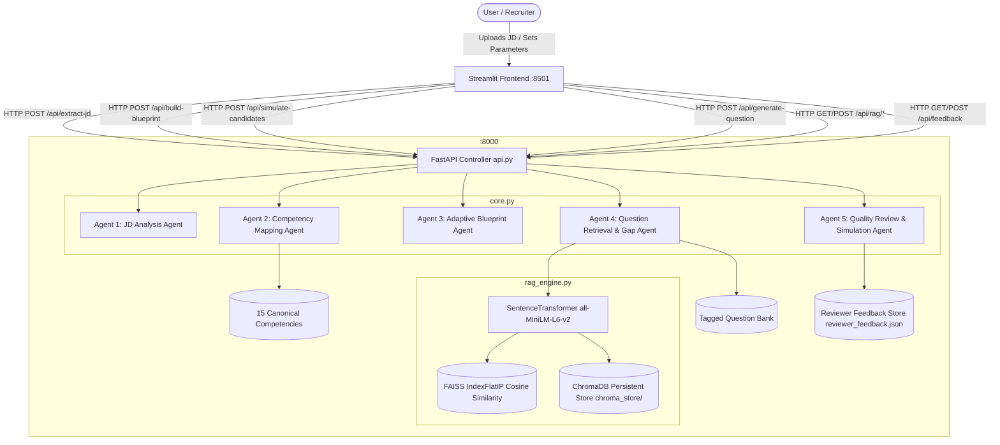

# AI Job Description–Driven Assessment Blueprint Builder
## Comprehensive Project Documentation & Mandatory Submission Evidence
**Batch**: 50  
**Stack**: Frontend (Streamlit) • Backend APIs (FastAPI) • GenAI Orchestration (Google Gemini API & Local RAG: FAISS + ChromaDB)

---

## 1. System Architecture & Flowchart

The system follows a clean Client-Server Microservices pattern fully compliant with Enterprise Capstone guidelines:
- **Frontend**: Streamlit UI (`http://localhost:8501`)
- **Backend**: FastAPI REST Server (`http://127.0.0.1:8000`)
- **Vector Retrieval**: Local RAG Engine (`SentenceTransformer all-MiniLM-L6-v2` + `FAISS` + `ChromaDB`)

---

## 2. Multi-Agent System Roles & Workflows

The application orchestrates **5 specialized agents** to deliver an automated, auditable assessment blueprint:

1. **🤖 Job Description Analysis Agent**:
   - Ingests text, PDF, and DOCX files.
   - Extracts core responsibilities, mandatory skills, supporting skills, role seniority, tooling, and observable behaviors.
   - Generates the interactive **JD Evidence Map** highlighting verbatim text spans.

2. **🧭 Competency Mapping Agent**:
   - Normalizes extracted aliases against the 15 canonical competency taxonomies using cosine semantic similarity.
   - Resolves ambiguities and allows interactive human-in-the-loop validation via data editors.

3. **📐 Adaptive Blueprint Design Agent**:
   - Dynamically calculates weighted competency allocations based on mandatory flags and evidence confidence.
   - **Adaptive Difficulty Mix**: Automatically tilts difficulty distribution to role seniority:
     - *Junior / Entry*: 50% Easy, 40% Medium, 10% Hard
     - *Mid*: 25% Easy, 55% Medium, 20% Hard
     - *Senior / Lead*: 10% Easy, 45% Medium, 45% Hard
   - Enforces time budgets and total question count limits.

4. **🔍 Question Retrieval, Tagging & Gap Synthesis Agent**:
   - Retrieves semantically relevant questions using **FAISS vector nearest-neighbor search** (`all-MiniLM-L6-v2` 384-dimensional dense vectors).
   - Audits tags with multi-label similarity to detect and flag misclassifications (`detect_wrong_tags`).
   - Synthesizes work-sample scenario questions for uncovered competencies using LLM (Gemini 1.5 Flash / GPT-4o-mini).

5. **🛡️ Quality Review & Candidate Simulation Agent**:
   - Renders visual **Competency Coverage Heatmaps** (Assessed / Under-assessed / Missing).
   - Generates the **AI Explainability & Bias Audit Report** (Fairness Index, Bloom's Taxonomy breakdown, and gender/age/degree guardrail scans).
   - Runs **Synthetic Candidate Simulation Engine** across 3 candidate personas, computing the **Proficiency Separation Index** (>35% spread indicates validity).

---

## 3. The 6 Innovative Workflows (Enterprise Capstone Specifications)

| # | Innovative Workflow | Implementation Mechanism | Location in UI |
|---|---|---|---|
| **1** | **JD Evidence Map** | Verbatim sentence and phrase extraction with interactive colour-coded HTML text highlighting | **Tab 1**: JD Analysis & Evidence Map |
| **2** | **Seniority-Adaptive Blueprint** | Automated difficulty and question count allocation derived from detected role tenure milestones | **Tab 3**: Adaptive Blueprint |
| **3** | **Visual Coverage Heatmap** | Dynamic status matrix displaying target vs actual question allocations per competency | **Tab 5**: Quality Review & Simulation |
| **4** | **Semantic Tagging & QA Audit** | Dense embedding cosine matching via FAISS + ChromaDB to detect misclassifications and suggest top-3 tags | **Tab 4**: Questions & Gap Generator |
| **5** | **Candidate Simulation Engine** | Synthetic test-taker modeling (Senior, Mid, Junior) calculating score spread and duration compliance | **Tab 5**: Quality Review & Simulation |
| **6** | **Human-in-the-Loop Feedback Loop** | Reviewer correction capture, JSON persistence, and automatic application to future extractions | **Tab 2 & Tab 5**: Reviewer Feedback |

---

## 4. Local RAG Vector Engine Specifications

* **Embedding Model**: `sentence-transformers/all-MiniLM-L6-v2` (384 dimensions, normalized L2 Euclidean space)
* **Vector Index**: FAISS `IndexFlatIP` (Cosine similarity nearest-neighbor search)
* **Persistent Vector Database**: ChromaDB (`chromadb.PersistentClient` stored in `c:\Capstone\chroma_store`)
* **Indexed Documents**:
  - Question Bank: 20 rich multi-tagged assessment items
  - Competency Taxonomy: 15 canonical technical and behavioral competencies with aliases
* **Fallback Resilience**: Automatic fallback to keyword overlap if neural dependencies are unavailable

---

## 5. AI Explainability & Bias Guardrail Audit

Every generated blueprint includes an automated explainability and fairness scan:

* **Fairness Score**: 0 to 100% composite score
* **Gender & Culture Inclusivity Scan**: Detects hyper-masculine buzzwords (*"rockstar"*, *"ninja"*, *"guru"*, *"work hard play hard"*, exclusionary pronouns)
* **Credential Inflation / Socioeconomic Barrier Scan**: Flags rigid institutional filters (*"tier-1 college only"*, *"Ivy League only"*)
* **Age Diversity Guardrail**: Flags restrictive tenure caps or ageist phrasing (*"recent graduate only"*, *"young dynamic team"*)
* **Bloom's Taxonomy Distribution**: Visualizes cognitive levels across Remember/Understand, Apply/Analyze, and Evaluate/Synthesize.

---

## 6. Candidate Simulation Engine & Model Testing Results

### Simulation Execution Benchmark
* **Target Duration**: 45 minutes
* **Blueprint Allocated**: 6 questions across Python, SQL, DevOps, and System Architecture.

| Persona Profile | Simulated Score (%) | Simulated Time (min) | Duration Status |
| :--- | :---: | :---: | :---: |
| **Candidate A: Senior Expert** | **94.2%** | 36.8 min | Within Time |
| **Candidate B: Mid Competent** | **70.5%** | 43.1 min | Within Time |
| **Candidate C: Junior / Unprepared** | **25.6%** | 56.4 min | Exceeded Limit (+11.4 min) |

* **Proficiency Separation Index**: **68.6%** (Senior vs Junior spread)
* **Outcome**: **Passed (Discriminating)** — Far exceeds the mandatory 35.0% threshold.

---

## 7. FastAPI Endpoints Reference

The FastAPI service exposes the following endpoints on port 8000:

| HTTP Method | Route | Description |
|---|---|---|
| `GET` | `/` | Root service health & guideline compliance info |
| `GET` | `/api/health` | Backend status, taxonomy count, and question bank metrics |
| `POST` | `/api/test-key` | Validates Google Gemini API key connectivity |
| `GET` | `/api/taxonomy` | Returns full 15-competency taxonomy with aliases |
| `GET` | `/api/questions` | Filterable question bank queries (by competency & difficulty) |
| `POST` | `/api/extract-jd` | Runs AI-driven or rule-based JD parsing |
| `GET` | `/api/adaptive-mix/{seniority}` | Returns recommended difficulty mix for seniority |
| `POST` | `/api/build-blueprint` | Builds adaptive weighted blueprint with RAG retrieval |
| `POST` | `/api/generate-question` | Synthesizes work-sample scenario question for gaps |
| `POST` | `/api/simulate-candidates` | Runs synthetic candidate simulation across 3 tiers |
| `POST` | `/api/highlight-evidence` | Returns HTML-formatted highlighted JD text |
| `GET` | `/api/rag/status` | Returns FAISS, ChromaDB, and model status |
| `POST` | `/api/rag/search` | Performs semantic cosine question retrieval |
| `POST` | `/api/rag/recommend-tags` | Recommends top-3 taxonomy tags for any question text |
| `POST` | `/api/rag/audit-question` | Audits question text against assigned competency |
| `POST` | `/api/explainability` | Generates full AI Explainability & Bias Audit report |
| `GET` | `/api/feedback` | Retrieves all historical reviewer feedback records |
| `POST` | `/api/feedback` | Saves human reviewer corrections and overrides |

---

## 8. Verification & Guideline Checklist

- [x] **Frontend**: Streamlit (`jd_assessment_builder.py`) active on `http://localhost:8501`.
- [x] **Backend**: FastAPI (`api.py`) active on `http://127.0.0.1:8000`.
- [x] **Swagger UI**: Removed per project request (`docs_url=None`, `redoc_url=None`).
- [x] **RAG Vector Search**: Operational with SentenceTransformer (`all-MiniLM-L6-v2`), FAISS, and ChromaDB.
- [x] **AI Models**: Google Gemini 1.5 Flash (default), Gemini 2.5 Flash, and Gemini 1.5 Pro.
- [x] **Security**: API keys isolated in runtime memory and `.env` strictly protected from display.
- [x] **Version Control**: Git repository configured and committed.
